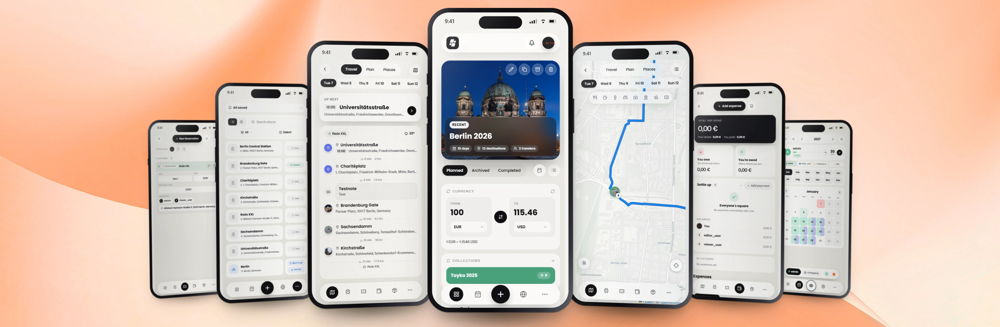
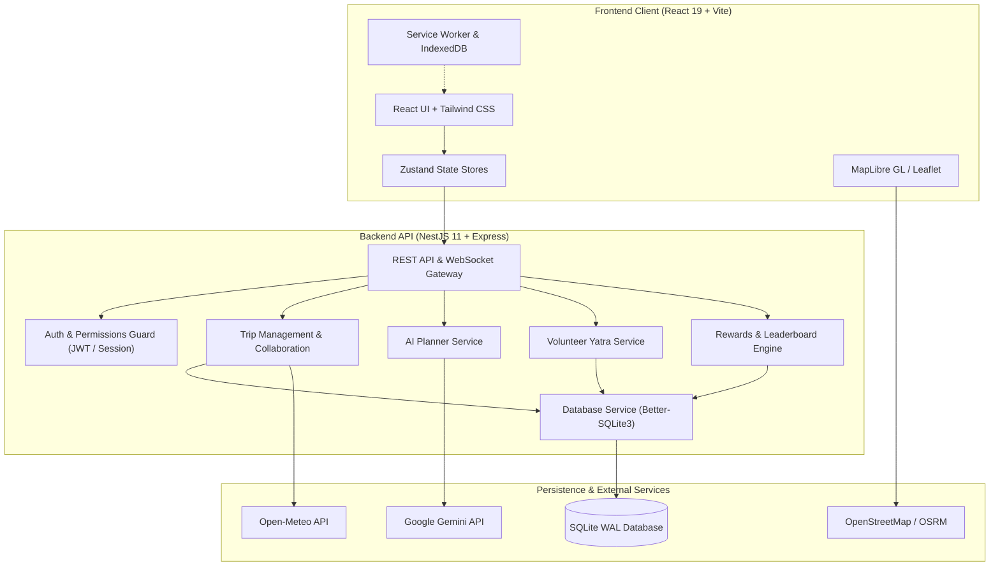

# TripMate

<div align="center">

<picture>
  <source media="(prefers-color-scheme: dark)" srcset="docs/logo-tripmate-light.svg" />
  <source media="(prefers-color-scheme: light)" srcset="docs/logo-tripmate-dark.svg" />
  
</picture>

<br />

<p align="center">
  <b>A Modern Full-Stack Collaborative Travel Planning & Experience Platform</b><br />
  Intelligent AI itinerary generation, community volunteering (Volunteer Yatra), gamified rewards, interactive map routing, multi-currency budget splitting, and offline-first PWA sync.
</p>

[](https://tripmate-5d81.onrender.com)
[](LICENSE)
[](https://nodejs.org/)
[](https://nestjs.com/)
[](https://react.dev/)
[](https://www.typescriptlang.org/)
[](https://www.sqlite.org/)
[](https://tailwindcss.com/)

[**Explore Live Application**](https://tripmate-5d81.onrender.com) • [**Architecture**](#system-architecture) • [**Key Features**](#key-features) • [**Tech Stack**](#technology-stack) • [**Local Setup**](#getting-started)

</div>

---

## Showcase

<div align="center">
  <a href="https://tripmate-5d81.onrender.com">
    
  </a>
  <br /><br />
  
  <br /><br />
  
</div>

---

## Overview

**TripMate** is a full-stack, real-time travel planning platform designed to solve the chaos of modern travel organization. Instead of juggling scattered spreadsheets, group chat messages, travel reservation emails, and isolated map bookmarks, TripMate unites the entire journey lifecycle into a single collaborative workspace.

From spontaneous weekend road trips to multi-week expeditions, TripMate combines algorithmic and AI-driven planning with practical trip logistics:

- **Intelligent Planning**: Instant, structured day-by-day itineraries generated by Google Gemini AI tailored to budget, travel style, and interests.
- **Collaborative Execution**: Real-time multi-user trip editing, interactive geocoding maps, activity scheduling, and expense splitting.
- **Purposeful Travel (Volunteer Yatra)**: A marketplace connecting conscious travelers with vetted community, ecological, and educational volunteering initiatives.
- **Gamified Rewards**: In-app points ledger, achievement tiers, and traveler leaderboards rewarding sustainable exploration and trip completion.
- **Resilient Architecture**: Offline-ready Progressive Web App (PWA) backed by high-performance SQLite in Write-Ahead Logging (WAL) mode.

---

## Key Features

### 1. Collaborative Itinerary & Activity Planning
- **Day-by-Day Scheduling**: Organize multi-day trips with sequenced morning, afternoon, and evening activity slots.
- **Interactive Map Routing**: MapLibre GL and Leaflet mapping with OpenStreetMap points of interest, auto-routing, and geocoded coordinates.
- **Real-Time Collaboration**: WebSocket gateway synchronizing itinerary edits, drag-and-drop reordering, and notes across all trip members simultaneously.
- **Attachment & Document Vault**: Centralized storage for flight tickets, hotel vouchers, train passes, and reservation PDFs.

### 2. Multi-Currency Budget & Expense Splitting
- **Dynamic Currency Conversion**: Real-time exchange rate calculations supporting global currencies via Frankfurter API.
- **Shared Group Splitting**: Track who paid for each expense, split costs equally or by custom percentages, and calculate minimum transaction settlements.
- **Category Analytics**: Visual spending breakdowns across accommodation, food, transit, activities, and emergency supplies with CSV export capabilities.

### 3. Travel Logistics & Checklists
- **Smart Packing Lists**: Categorized packing templates (clothing, electronics, documents, medical) with shared progress tracking.
- **Reservation Tracker**: Dedicated management for flights, accommodations, vehicle rentals, and activity permits with confirmation lookup.
- **Offline-First PWA**: Service Worker caching with IndexedDB mutations allowing uninterrupted access in low-connectivity travel destinations.

---

## AI Trip Planner & Travel Assistant

TripMate integrates Google Gemini to deliver production-grade AI trip generation:

```
User Prompt (Destination, Days, Budget, Style)
                    │
                    ▼
  [NestJS AI Engine — Server-Side Validation]
                    │
                    ▼
     [Google Gemini API — JSON Mode]
                    │
                    ▼
[Validated Structured Schema (Days, Places, Costs)]
                    │
                    ▼
  [Instant One-Click Conversion into TripMate Trip]
```

- **Structured Itinerary Generation**: Users specify destination, dates, budget tier (budget, moderate, luxury), and travel style (adventure, cultural, relaxation, backpacking). Gemini returns fully structured day plans with estimated timings, descriptions, and budgets.
- **One-Click Native Trip Creation**: Unlike static chat bots, generated itineraries convert directly into real TripMate database entities with linked places, days, budget rows, and map pins.
- **Contextual Travel Assistant**: In-app conversational AI assistant capable of answering destination-specific queries, packing recommendations, visa considerations, and regional safety advisories.
- **Zero Client Credential Leakage**: All Gemini interactions run strictly on the backend; API keys are never exposed to client-side bundles or browser storage.

---

## Volunteer Yatra (Travel & Volunteer)

**Volunteer Yatra** brings social and ecological impact into travel planning by connecting travelers with grassroots initiatives across India and beyond.

- **Curated Opportunity Marketplace**: Explore verified volunteering placements in organic farming, rural education, high-altitude trail cleanups, and wildlife rehabilitation.
- **Detailed Impact & Perks**: View required skills, minimum time commitments, provided accommodations, complimentary meals, and monthly living stipends.
- **Application Workflow**: In-app application submissions with personal motivation letters, resume links, and persistent status tracking (`Pending`, `Accepted`, `Rejected`, `Completed`).
- **Saved Favorites**: Bookmark impactful programs directly to personal travel profiles for upcoming seasons.

> **Note on Volunteer Listings**: Volunteer opportunities, stipends, and host details are curated demonstration records designed for platform presentation. They do not constitute legally binding employment agreements.

---

## Rewards & Gamification Engine

TripMate incentivizes eco-conscious travel, community contributions, and active planning through a full rewards economy:

- **Points Ledger**: Earn points through concrete platform actions:
  - Completing scheduled trips (`+500 pts`)
  - Submitting travel reviews and trail photos (`+600 pts`)
  - Participating in Volunteer Yatra programs (`+550 pts`)
  - Completing packing lists and eco-milestones (`+300 pts`)
- **Tiered Leaderboard**: Global traveler rankings categorized across **Bronze Explorer**, **Silver Voyager**, **Gold Adventurer**, and **Platinum Wanderer**.
- **Perk Catalog**: Redeem earned points for simulated partner vouchers, hostel discounts, eco-gear merchandise, and digital certificates of impact.

---

## System Architecture

TripMate employs a modular monorepo architecture with clean separation of concerns, strict TypeScript contracts, and transactional persistence:



---

## Technology Stack

| Layer | Technologies | Rationale |
|---|---|---|
| **Frontend** | React 19, TypeScript 5.x, Vite, Tailwind CSS 3.x | Lightning-fast HMR, concurrent React rendering, atomic utility styling. |
| **State & Data** | Zustand, React Router 7, Lucide Icons, MapLibre GL | Predictable state flow, unified routing, high-performance vector map tiles. |
| **Backend** | NestJS 11, Node.js 22 LTS, Express Platform | Enterprise modular architecture, dependency injection, robust validation pipes. |
| **Persistence** | SQLite via `better-sqlite3`, WAL Mode, PRAGMA transactions | Zero-latency embedded reads/writes, concurrent multi-thread readers, ACID guarantees. |
| **Real-Time** | WebSockets (`@nestjs/platform-ws`), Event Emitters | Bidirectional low-latency state synchronization for concurrent trip collaborators. |
| **AI Integration** | Google Gemini API (`@google/genai` / REST) | State-of-the-art multimodal reasoning, structured JSON response mode. |
| **Security** | BcryptJS, JWT, HTTP-only Secure Cookies, Zod 4 | Bulletproof authentication, session hardening, schema-driven input sanitization. |
| **Deployment** | Docker multi-stage build, Render Cloud Platform | Minimal runtime container size (<180MB), automated CI/CD branch deployments. |

---

## Getting Started

### Prerequisites
- **Node.js**: `v22.x` (LTS recommended)
- **Package Manager**: `npm v10+`
- **Git**: `v2.x`

### 1. Clone the Repository
```bash
git clone https://github.com/dakshgola/TripMate.git
cd TripMate
```

### 2. Install Monorepo Dependencies
```bash
npm install
```

### 3. Build the Shared Contract Library
```bash
npm run build --workspace=shared
```

### 4. Configure Environment Variables
Copy the sample environment file into `server/.env`:
```bash
# On Linux / macOS:
cp server/.env.example server/.env

# On Windows PowerShell:
Copy-Item server\.env.example server\.env
```

Open `server/.env` and insert your Google Gemini API key:
```dotenv
GEMINI_API_KEY=your_actual_gemini_api_key_here
PORT=3001
NODE_ENV=development
```
*(Get a free API key at [Google AI Studio](https://aistudio.google.com/app/apikey))*.

### 5. Start the Development Servers
```bash
# Launch both frontend and backend concurrently:
npm run dev
```

The application will be available at:
- **Frontend Client**: `http://localhost:5173`
- **Backend REST API**: `http://localhost:3001`
- **Health Check**: `http://localhost:3001/api/health`

---

## Environment Variables

| Variable | Default | Description |
|---|---|---|
| `PORT` | `3001` | HTTP port for the NestJS server. |
| `NODE_ENV` | `development` | Environment mode (`development` or `production`). |
| `GEMINI_API_KEY` | *Required for AI* | Google Gemini API key for itinerary generation and chat. |
| `APP_URL` | `http://localhost:5173` | Base client application URL for CORS and redirect resolution. |
| `ALLOWED_ORIGINS` | `http://localhost:5173` | Comma-separated list of allowed frontend origins for CORS. |
| `COOKIE_SECURE` | Auto | Enforces `Secure` flag on session cookies (automatically true in production). |
| `SEED_ADMIN_DEMO` | `true` | Idempotently populates 6 demo trips, 2450 points, and leaderboard travelers on startup. |
| `ADMIN_EMAIL` | `admin@tripmate.local` | Primary administrator account email address. |
| `ADMIN_RECOVERY_SECRET` | *Optional* | Secret passphrase for web-based one-time admin account recovery. |

---

## Project Structure

```text
TripMate/
├── client/                     # Frontend Application (React 19 + Vite)
│   ├── src/
│   │   ├── api/                # Typed Axios API client & endpoints
│   │   ├── components/         # Modular UI components (Navigation, Modals, Maps)
│   │   ├── pages/              # Route views (AI Planner, Volunteer, Trips, Auth)
│   │   ├── store/              # Zustand global application state stores
│   │   └── types/              # Frontend TypeScript definitions
│   ├── public/                 # Static PWA assets, icons, and fonts
│   └── package.json
│
├── server/                     # Backend Application (NestJS 11)
│   ├── src/
│   │   ├── nest/
│   │   │   ├── ai-planner/     # Google Gemini itinerary generation & chat engine
│   │   │   ├── volunteer/      # Volunteer Yatra marketplace & application logic
│   │   │   ├── rewards/        # Gamification points ledger & leaderboard service
│   │   │   ├── auth/           # Authentication, session cookies & user recovery
│   │   │   ├── trips/          # Trip lifecycle, days, activities & collaboration
│   │   │   └── database/       # Better-sqlite3 transactional database service
│   │   ├── db/                 # SQLite schema definitions, migrations & demo seeders
│   │   └── scripts/            # Standalone database and migration utilities
│   ├── data/                   # SQLite database storage directory (travel.db)
│   └── package.json
│
├── shared/                     # Shared TypeScript Contracts & Schemas
│   ├── src/
│   │   ├── auth/               # Shared authentication request/response schemas
│   │   └── trips/              # Shared data contracts
│   └── package.json
│
├── docs/                       # Project screenshots, logos, and architecture assets
├── Dockerfile                  # Multi-stage optimized production container build
├── render.yaml                 # Render cloud infrastructure as code configuration
├── package.json                # Monorepo root workspaces configuration
└── README.md                   # Project documentation
```

---

## Verification & Testing

TripMate maintains comprehensive test coverage across both unit and integration levels:

```bash
# Run backend Vitest unit test suite:
npm run test --workspace=server

# Run frontend test suite:
npm run test --workspace=client

# Build production bundle for container deployment:
npm run build
```

---

## Roadmap & Future Enhancements

- [ ] **Automated Flight & Fare Tracking**: In-app price alert webhooks for monitored flight legs.
- [ ] **Multi-Day Route Optimization**: Traveling Salesperson Problem (TSP) heuristic solver for day activity paths.
- [ ] **Native Mobile Releases**: Packaging via Capacitor / React Native for Google Play Store and Apple App Store.
- [ ] **Shared Collaborative Split-Pay**: Direct UPI and Stripe integration for instant in-app group expense settlement.

---

## License

This project is licensed under the **GNU Affero General Public License v3.0 (AGPL-3.0)** — see the [LICENSE](LICENSE) file for details.

---

<div align="center">

**Developed by [Daksh Gola](https://github.com/dakshgola)**  
*TripMate — Plan Smarter. Travel Together. Explore More.*

</div>
