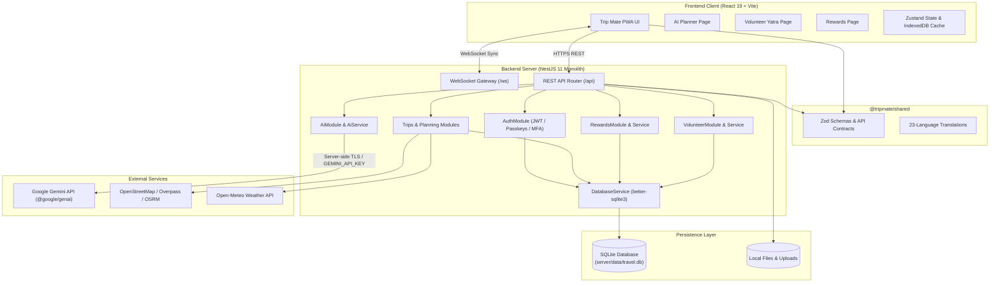

# Trip Mate

<div align="center">

<picture>
  <source media="(prefers-color-scheme: dark)" srcset="docs/logo-trek-light.svg" />
  <source media="(prefers-color-scheme: light)" srcset="docs/logo-trek-dark.svg" />
  
</picture>

<br />

<picture>
  <source media="(prefers-color-scheme: dark)" srcset="docs/subtitle-light.png" />
  <source media="(prefers-color-scheme: light)" srcset="docs/subtitle-dark.png" />
  
</picture>

<p align="center">
  <b>A modern, self-hosted, real-time collaborative travel planning and management platform.</b><br />
  Featuring intelligent AI itinerary planning, purposeful volunteer journeys (Volunteer Yatra), gamified rewards, interactive maps, split budgets, packing checklists, and offline-first PWA capabilities.
</p>

[](LICENSE)
[](https://nodejs.org/)
[](https://nestjs.com/)
[](https://react.dev/)
[](https://www.typescriptlang.org/)
[](https://www.sqlite.org/)
[](https://tailwindcss.com/)

</div>

---

## Showcase

<div align="center">
  
  <br /><br />
  
  <br /><br />
  
</div>

---

## Table of Contents

- [Overview](#overview)
- [Core Feature Modules](#core-feature-modules)
  - [1. AI Planner & Travel Assistant](#1-ai-planner--travel-assistant)
  - [2. Volunteer Yatra (Travel, Learn & Earn)](#2-volunteer-yatra-travel-learn--earn)
  - [3. Rewards & Leaderboard](#3-rewards--leaderboard)
  - [Existing Platform Capabilities](#existing-platform-capabilities)
- [System Architecture](#system-architecture)
  - [High-Level Architecture Diagram](#high-level-architecture-diagram)
  - [Monorepo Workspace Structure](#monorepo-workspace-structure)
- [Technology Stack](#technology-stack)
- [Installation & Setup (Windows PowerShell)](#installation--setup-windows-powershell)
  - [Prerequisites](#prerequisites)
  - [Step-by-Step PowerShell Setup](#step-by-step-powershell-setup)
- [Configuration & Environment Variables](#configuration--environment-variables)
  - [Backend Configuration (`server/.env`)](#backend-configuration-serverenv)
  - [Strict Backend Gemini API Key Isolation](#strict-backend-gemini-api-key-isolation)
- [Development, Build & Test Commands](#development-build--test-commands)
- [Database & API Architecture](#database--api-architecture)
  - [SQLite Persistence & Migrations](#sqlite-persistence--migrations)
  - [REST API Endpoints](#rest-api-endpoints)
- [Security Considerations](#security-considerations)
- [Project Limitations & Disclaimers](#project-limitations--disclaimers)
- [Data Sources & Attributions](#data-sources--attributions)
- [License](#license)

---

## Overview

**Trip Mate** is a complete, self-hosted travel management platform designed to replace fragmented spreadsheets, notes, and booking confirmations with an intuitive, unified workspace. 

Whether planning an individual expedition, coordinating a road trip with friends, or engaging in purposeful community volunteering, Trip Mate provides real-time collaborative day planning, currency-converting expense splits, interactive route maps, packing lists, and offline support.

The platform includes three specialized modules:
1. **AI Planner**: Server-side Google Gemini integration for instant, structured itinerary generation and conversational travel assistance.
2. **Volunteer Yatra**: Dedicated marketplace and tracking engine for experiential learning, community volunteer programs, and stipend monitoring.
3. **Rewards & Leaderboard**: Gamification system that rewards sustainable travel, itinerary completion, and community contributions with points, badges, and unlockable perks.

---

## Core Feature Modules

### 1. AI Planner & Travel Assistant

The **AI Planner** leverages Google Gemini generative AI to build customized, day-by-day travel itineraries and provide real-time travel advice.

```
Browser (React UI) ──► POST /api/ai/plan-itinerary ──► NestJS AiService ──► Google Gemini API
Browser (React UI) ◄── Validated JSON Response   ◄── Zod Validation ◄── Structured Output
```

* **Itinerary Generation**:
  * **Input Parameters**: Destination, travel dates, trip duration (number of days), budget tier, target currency, travel style (backpacking, cultural, luxury, adventure, relaxation, family), user interests, and season.
  * **Structured Schema Enforcement**: All Gemini responses are validated through server-side schemas to guarantee exact day counts, structured time blocks (Morning, Afternoon, Evening), realistic estimated activity costs, matching currencies, and non-empty place descriptions.
  * **Direct "Create Trip" Action**: Generated itineraries can be converted directly into persistent Trip Mate trips with a single click, automatically creating days, timeline entries, and map markers.
* **AI Travel Assistant**:
  * Persistent conversational chat interface (`/api/ai/chat`) to refine recommendations, ask about local customs, receive packing tips, or adapt itineraries to unexpected weather.
* **Safe Status Inspection**:
  * The `/api/ai/status` endpoint allows the frontend to inspect whether AI features are enabled and configured without ever revealing secret credentials.

---

### 2. Volunteer Yatra (Travel, Learn & Earn)

**Volunteer Yatra** bridges conscious travel with experiential learning by connecting travelers to educational, ecological, and community volunteering programs.

* **Curated Opportunity Marketplace**:
  * Explore volunteer opportunities across domains including organic farming, rural school teaching, wildlife rescue, hostel hospitality, and eco-trail building.
  * Real-time search by keywords, location, duration, and stipend status.
* **Persistent Application Workflow**:
  * Complete application submission persisting applicant name, email, phone number, portfolio/LinkedIn URL, and personal motivation statement.
  * Prevents duplicate active applications for the same opportunity.
  * Application lifecycle status tracking:
    * `PENDING`: Application submitted and awaiting review.
    * `ACCEPTED`: Host accepted the applicant.
    * `REJECTED`: Application declined.
    * `COMPLETED`: Volunteering placement successfully concluded.
    * `CANCELLED`: Withdrawn by the applicant.
* **Stipend & Benefit Tracking**:
  * Clear overview of free accommodation, meals, certificates, and agreed monthly or weekly stipends.
* **Favorites & Bookmarks**:
  * Authenticated user bookmarking with instant toggle and persistent SQLite storage across browser sessions.

> [!NOTE]
> **Educational & Community Scope**: Volunteer opportunities, host listings, and stipend amounts in this repository are curated demo records designed for educational demonstration and community travel workflows. They do not constitute legally binding employment or independently verified commercial contracts.

---

### 3. Rewards & Leaderboard

**Rewards & Leaderboard** adds a gamification and incentive layer to encourage sustainable travel habits, collaborative planning, and volunteer engagement.

* **Points Engine**:
  * Earn points across various activities:
    * Trip Completion: **+500 points** upon marking a planned trip as concluded.
    * Volunteer Placement: Points awarded for active volunteering contributions.
    * Eco-Milestones & Packing: Points for completing zero-waste checklists and packing readiness.
* **Dynamic Leaderboard**:
  * Ranks travelers globally based on accumulated points and contributions.
  * Displays tier badges: *Bronze Explorer*, *Silver Voyager*, *Gold Adventurer*, and *Platinum Wanderer*.
* **Reward Catalog & Redemption**:
  * In-app catalog featuring travel perks, partner gear discounts, digital certificates, and hostel vouchers.
  * Real-time balance deduction with unique redemption code generation and transaction history tracking.

> [!NOTE]
> **In-App Redemption Mechanics**: Reward catalog items and coupon codes are simulated in-app redemption credits demonstrating gamification architecture; they are not externally redeemable vouchers with third-party commercial merchants without active commercial API integration.

---

### Existing Platform Capabilities

Trip Mate includes a rich foundation of self-hosted travel utilities:

* **Interactive Mapping**: Leaflet and MapLibre GL support with OpenStreetMap, Mapbox, Overpass POI queries, and OSRM route calculations.
* **Real-time Collaboration**: WebSocket (`ws`) synchronization allows multiple users to edit itineraries, notes, and packing items concurrently.
* **Shared Expense Splitting**: Multi-currency expense splitting with fixed exchange rates, custom shares, settlement optimization, and CSV export.
* **Luggage & Packing Lists**: Categorized packing lists with templates, assignments, baggage weight rollups, and to-do reminders.
* **Document & Reservation Hub**: Store flight, train, hotel, and rental car reservations with attached PDFs and confirmation codes.
* **Offline-First PWA**: Progressive Web App with service worker caching, IndexedDB persistence, and an offline mutation queue that replays edits upon reconnection.
* **Atlas & Travel Journal**: Mark visited countries and regions on geoBoundaries maps, track consecutive travel years, and maintain multimedia travel stories.

---

## System Architecture

### High-Level Architecture Diagram



---

### Monorepo Workspace Structure

Trip Mate is organized as a unified monorepo powered by **npm workspaces**:

```text
TRIP-MATE--feat-ai-trip-planner-volunteer/
├── client/                     # Frontend Vite + React 19 Single Page Application
│   ├── src/
│   │   ├── components/         # Reusable UI components, modals, and layouts
│   │   ├── pages/              # Route pages (AiPlannerPage, VolunteerPage, RewardsPage, etc.)
│   │   ├── services/           # Frontend API client and backend connectors
│   │   └── store/              # Zustand state management and offline cache
│   ├── package.json
│   └── vite.config.ts
├── server/                     # Backend NestJS 11 application
│   ├── src/
│   │   ├── nest/
│   │   │   ├── ai/             # AI Planner module, Gemini service, prompt schemas
│   │   │   ├── volunteer/      # Volunteer Yatra module, controller, repository
│   │   │   ├── rewards/        # Rewards and Leaderboard engine
│   │   │   ├── database/       # DatabaseService, SQLite initialization, 244 migrations
│   │   │   └── ...             # Auth, Trips, Maps, Storage, Collab modules
│   ├── data/                   # SQLite database (travel.db) and encryption key
│   ├── .env                    # Active local environment variables (never committed)
│   ├── .env.example            # Template for server configuration
│   └── package.json
├── shared/                     # Shared Zod schemas, contracts, and i18n
│   ├── src/                    # Schema definitions and validation rules
│   ├── dist/                   # Compiled CJS/ESM modules consumed by client & server
│   └── package.json
├── docs/                       # Screenshots, architecture diagrams, and static assets
├── package.json                # Root workspace configuration (@tripmate/root)
└── README.md                   # Project documentation
```

---

## Technology Stack

| Layer | Technology | Details |
| :--- | :--- | :--- |
| **Frontend Framework** | **React 19** | Modern functional components, hooks, concurrent rendering |
| **Build Tool** | **Vite 8** | Lightning-fast HMR and optimized asset bundling |
| **Styling** | **Tailwind CSS** | Utility-first responsive design, dark/light theme support |
| **State Management** | **Zustand** | Lightweight reactive store with local persistence |
| **Mapping & GIS** | **Leaflet & MapLibre GL** | Vector/raster tiles, clustering, route polylines |
| **Backend Framework** | **NestJS 11** | TypeScript modular architecture, dependency injection |
| **Language Models** | **Google Gemini SDK** | `@google/genai` on backend (`gemini-2.5-flash` / `gemini-flash-lite-latest`) |
| **Database** | **SQLite 3** | Embedded high-performance database via `better-sqlite3` |
| **Database Engine** | **WAL Mode** | Write-Ahead Logging (`PRAGMA journal_mode=WAL`) |
| **Realtime Sync** | **WebSockets (`ws`)** | Low-latency state synchronization across concurrent clients |
| **Validation** | **Zod 4** | Runtime schema parsing and contract verification in `@tripmate/shared` |
| **Authentication** | **Passport / JWT / WebAuthn** | HTTP-only cookies, Passkey fingerprint/PIN login, TOTP 2FA |
| **Package Manager** | **npm Workspaces** | Multi-package workspace orchestration (`@tripmate/root`) |

---

## Installation & Setup (Windows PowerShell)

### Prerequisites

Ensure the following tools are installed on your Windows machine:
* **Node.js**: `v20.x` or `v22.x LTS` (verified on `v22.18.0`)
* **npm**: `v10.x` or higher (verified on `10.9.3`)
* **Git**: `v2.x`
* **Google Chrome** (or any modern Chromium-based browser)

---

### Step-by-Step PowerShell Setup

#### 1. Navigate to the Correct Project Root
Open Windows PowerShell and navigate to the directory containing the root `package.json` (`@tripmate/root`):

```powershell
Set-Location "C:\Users\Daksh gola\Downloads\TRIP-MATE--feat-ai-trip-planner-volunteer\TRIP-MATE--feat-ai-trip-planner-volunteer"
```

#### 2. Install Project Dependencies
Install all workspace dependencies using npm:

```powershell
npm install
```

#### 3. Build the Shared Package
Compile the shared Zod contracts and internationalization bundle so both `client` and `server` can resolve `@tripmate/shared`:

```powershell
npm run build --workspace=shared
```

#### 4. Configure Backend Environment
Create your `server/.env` file from the provided template:

```powershell
Copy-Item server\.env.example server\.env
```

Open `server/.env` in your editor and add your Google Gemini API key:
```dotenv
GEMINI_API_KEY=your_actual_gemini_api_key_here
```

#### 5. Run the Complete Application
Launch the shared watcher, NestJS backend, and Vite frontend concurrently:

```powershell
$env:NODE_OPTIONS = "--max-old-space-size=4096"
npm run dev
```

#### 6. Open Trip Mate in Chrome
Once compilation finishes, open your browser:
* **Frontend Web App**: [http://localhost:5173/](http://localhost:5173/)
* **Backend API**: [http://localhost:3001/](http://localhost:3001/)
* **AI Configuration Status**: [http://localhost:3001/api/ai/status](http://localhost:3001/api/ai/status)

---

## Configuration & Environment Variables

### Backend Configuration (`server/.env`)

All server configuration is managed via `server/.env`. The table below lists the essential variables:

| Variable | Default | Description |
| :--- | :--- | :--- |
| `PORT` | `3001` | TCP port for the NestJS HTTP & WebSocket server |
| `NODE_ENV` | `development` | Runtime mode (`development` or `production`) |
| `TZ` | `UTC` | Timezone for logs, reminders, and scheduled tasks |
| `ALLOWED_ORIGINS` | `http://localhost:5173` | Allowed origins for CORS validation and secure cookie headers |
| `COOKIE_SECURE` | `false` in dev | When `true`, enforces `Secure` attribute on session cookies (requires HTTPS) |
| `ENCRYPTION_KEY` | *(Auto-generated)* | 256-bit hexadecimal key used to encrypt stored credentials at rest |
| `GEMINI_API_KEY` | `""` | **Required.** Google Gemini API key for AI Planner & Travel Assistant |

---

### Strict Backend Gemini API Key Isolation

> [!IMPORTANT]
> **Zero Browser-Side Credential Exposure**:
> * `GEMINI_API_KEY` resides strictly in `server/.env` and is loaded exclusively on the backend via NestJS `ConfigService`.
> * The client browser **never** stores, reads, or transmits the Gemini API key.
> * There are no `VITE_GEMINI_API_KEY` variables, `localStorage` key items, or direct browser calls to `generativelanguage.googleapis.com`.
> * All AI requests are routed through authenticated backend endpoints (`POST /api/ai/plan-itinerary`, `POST /api/ai/chat`), keeping the API key completely private.

---

## Development, Build & Test Commands

All scripts are executed from the repository root using npm workspaces:

### Development Commands
```powershell
# Run the entire stack concurrently (shared watch + backend dev + frontend dev)
npm run dev

# Run only the NestJS backend in watch mode
npm run dev --workspace=server

# Run only the Vite frontend dev server
npm run dev --workspace=client

# Watch-recompile the shared package on file changes
npm run build:watch --workspace=shared
```

### Production Build Commands
```powershell
# Build all packages for production in topological order
npm run build

# Build individual workspaces
npm run build --workspace=shared
npm run build --workspace=server
npm run build --workspace=client
```

### Testing & Code Quality
```powershell
# Run unit and integration tests across all packages
npm run test

# Run tests with test coverage reporting
npm run test:cov

# Run linter across shared, server, and client
npm run lint

# Format code across all packages using Prettier
npm run format

# Verify formatting without modifying files
npm run format:check
```

---

## Database & API Architecture

### SQLite Persistence & Migrations

* **Engine**: Embedded SQLite using `better-sqlite3`.
* **Database File**: `server/data/travel.db`
* **Concurrency Configuration**:
  * `PRAGMA journal_mode = WAL;` (Write-Ahead Logging provides optimal concurrent read/write performance).
  * `PRAGMA synchronous = NORMAL;` (Ensures zero disk latency bottlenecks while maintaining ACID integrity).
* **Automated Migrations**: The `DatabaseService` manages an automated migration pipeline consisting of **244 sequential migrations**. On application boot, missing migrations are executed in a single transaction before incoming requests are accepted.

---

### REST API Endpoints

The backend exposes structured REST endpoints under the `/api` prefix:

#### AI Planner Endpoints
| Method | Endpoint | Description |
| :--- | :--- | :--- |
| `GET` | `/api/ai/status` | Returns whether the Gemini integration is configured and active |
| `POST` | `/api/ai/plan-itinerary` | Accepts travel parameters and generates a validated multi-day itinerary |
| `POST` | `/api/ai/chat` | Contextual travel assistant chat for advice, recommendations, and edits |

#### Volunteer Yatra Endpoints
| Method | Endpoint | Description |
| :--- | :--- | :--- |
| `GET` | `/api/volunteer/opportunities` | Returns all available volunteer programs with optional query filters |
| `GET` | `/api/volunteer/opportunities/:id` | Returns details for a specific opportunity |
| `POST` | `/api/volunteer/applications` | Submits a new volunteer application with duplicate prevention |
| `GET` | `/api/volunteer/applications/mine` | Retrieves all applications submitted by the current user |
| `PATCH` | `/api/volunteer/applications/:id/status` | Updates application state (`PENDING`, `ACCEPTED`, `REJECTED`, etc.) |
| `GET` | `/api/volunteer/favorites` | Returns the list of bookmarked opportunity IDs for the user |
| `POST` | `/api/volunteer/favorites/:id` | Toggles bookmark status for an opportunity |

#### Rewards Endpoints
| Method | Endpoint | Description |
| :--- | :--- | :--- |
| `GET` | `/api/rewards/leaderboard` | Retrieves top ranked travelers, badge tiers, and total points |
| `GET` | `/api/rewards/me` | Returns current user points balance, rank, and redemption history |
| `GET` | `/api/rewards/catalog` | Returns active reward catalog items, discount tiers, and point costs |
| `POST` | `/api/rewards/redeem` | Redeems an item, deducts user points, and generates a redemption code |
| `POST` | `/api/rewards/trips/:tripId/complete` | Awards completion points (+500 pts) for a concluded trip |

---

## Security Considerations

1. **Backend LLM Proxying**: All interactions with generative language models are mediated by the backend server. API keys, system instructions, and temperature settings cannot be inspected or tampered with by the client.
2. **Encrypted Secret Storage**: Sensitive settings (OAuth client secrets, SMTP passwords, MFA seeds) are encrypted with AES-256-GCM using `ENCRYPTION_KEY` before persisting to SQLite.
3. **Session & Token Hardening**: Authentication uses HTTP-only, SameSite, signed JWT session cookies, protecting against Cross-Site Scripting (XSS) credential theft.
4. **Input Sanitization & Schema Validation**: User inputs are sanitized using `isomorphic-dompurify` and strictly validated at runtime against Zod schemas.
5. **SSRF Guard**: Outbound network requests (e.g., webhook notifications, map queries, external calendar sync) are validated against private IP blacklists to prevent Server-Side Request Forgery.

---

## Project Limitations & Disclaimers

* **LLM Rate Limits & Quotas**: AI itinerary generation depends on your Google Gemini API quota tier. If the Gemini API experiences rate limits or network degradation, the backend gracefully returns safe error responses.
* **Single-Node Embedded SQLite**: SQLite is designed for single-process host execution. For multi-server horizontal scaling, a distributed database architecture would be required.
* **Offline Limitations**: While trips, notes, and packing lists are cached offline via IndexedDB, AI itinerary planning, real-time geocoding, and multiplayer WebSockets require an active internet connection.
* **Demo Scope for Volunteer Programs**: Volunteer listings, host organizations, and stipend details are curated records designed for experiential travel workflows and educational demonstrations; they do not represent legally binding or independently audited host contracts.
* **Simulated Rewards Redemption**: Reward catalog vouchers, discount codes, and travel badges are internal gamification mechanics and cannot be redeemed with external commercial retailers without direct third-party merchant integrations.

---

## Data Sources & Attributions

* **Map Boundaries**: Administrative and national borders provided by [geoBoundaries](https://www.geoboundaries.org/) (Runfola et al., 2020), licensed under [CC BY 4.0](https://creativecommons.org/licenses/by/4.0/).
* **Geocoding & POI Data**: [OpenStreetMap](https://www.openstreetmap.org/) contributors, [Overpass API](https://overpass-turbo.eu/), and [OSRM](http://project-osrm.org/).
* **Weather Data**: Forecasts and archival historical weather courtesy of [Open-Meteo](https://open-meteo.com/) (No API key required).
* **Currency Exchange Rates**: Provided by [Frankfurter](https://www.frankfurter.app/) open-source exchange rate API.
* **Upstream Attribution**: Based on and adapted from the open-source Trek travel planner project by Maurice Boe and community contributors.

---

## License

Trip Mate is licensed under the **GNU Affero General Public License v3.0 (AGPL-3.0)**.

```text
Trip Mate — Collaborative Travel Planner with AI, Volunteer Yatra & Rewards
Copyright (C) 2026 Trip Mate Contributors & upstream authors.

This program is free software: you can redistribute it and/or modify
it under the terms of the GNU Affero General Public License as published by
the Free Software Foundation, either version 3 of the License, or
(at your option) any later version.

This program is distributed in the hope that it will be useful,
but WITHOUT ANY WARRANTY; without even the implied warranty of
MERCHANTABILITY or FITNESS FOR A PARTICULAR PURPOSE. See the
GNU Affero General Public License for more details.
```

See the [LICENSE](LICENSE) file for the full license text.
