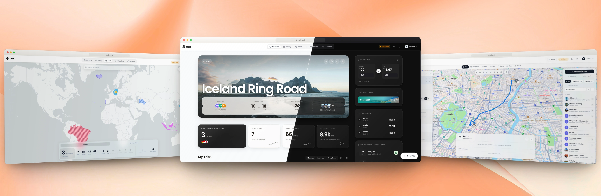
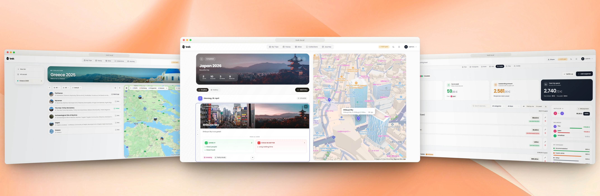
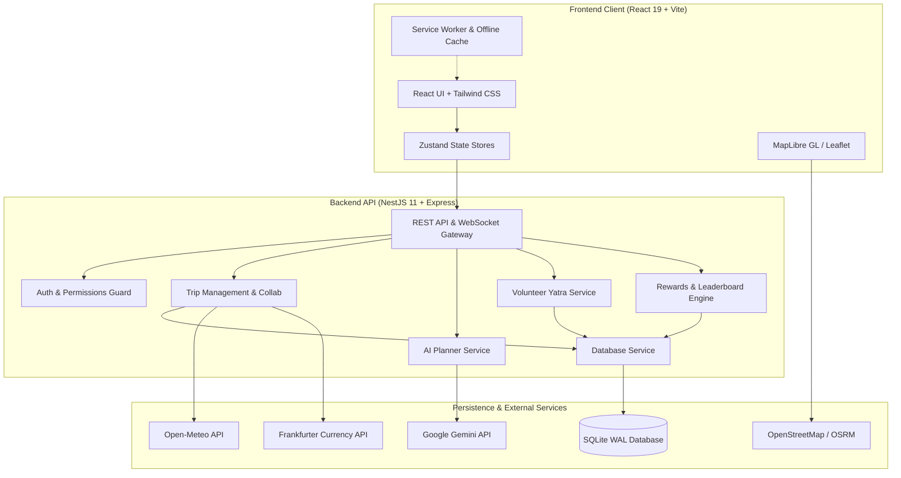

# TripMate

<div align="center">

<picture>
  <source media="(prefers-color-scheme: dark)" srcset="docs/logo-tripmate-light.svg" />
  <source media="(prefers-color-scheme: light)" srcset="docs/logo-tripmate-dark.svg" />
  
</picture>

<br />

<p align="center">
  <b>A Modern Full-Stack Travel Planning & Real-Time Collaborative Platform</b><br />
  Intelligent AI itinerary generation, purposeful community volunteering, gamified rewards, interactive map routing, multi-currency expense splitting, and offline-first PWA sync.
</p>

[](https://tripmate-5d81.onrender.com)
[](https://react.dev/)
[](https://nestjs.com/)
[](https://www.typescriptlang.org/)
[](https://www.sqlite.org/)
[](https://tailwindcss.com/)
[](https://nodejs.org/)

[**Live Demo**](https://tripmate-5d81.onrender.com) • [**Architecture**](#system-architecture) • [**Core Features**](#core-features) • [**Tech Stack**](#technology-stack) • [**Getting Started**](#getting-started) • [**Project Structure**](#project-structure)

</div>

---

## Overview

Planning group or solo travel is traditionally chaotic: itineraries sit in spreadsheets, discussions disappear in chat apps, reservations get lost in inboxes, and expenses are hard to reconcile.

**TripMate** solves this problem by uniting the entire travel journey into a unified, full-stack workspace. Users can effortlessly brainstorm itineraries with AI, coordinate schedules with fellow travelers in real time, explore interactive points of interest on a map, split group expenses across multiple currencies, and engage in purposeful community initiatives through Volunteer Yatra.

### Key Highlights
- **AI-Driven Planning**: Tailored, multi-day itineraries and packing guidance powered by Google Gemini.
- **Real-Time Collaboration**: Instant itinerary updates and shared schedules powered by WebSockets.
- **Purposeful Travel (Volunteer Yatra)**: A marketplace connecting travelers to meaningful grassroots volunteering initiatives.
- **Gamified Rewards**: Points ledger and tiered global leaderboards recognizing sustainable exploration.
- **Offline Resiliency**: Progressive Web App (PWA) with service-worker caching and local mutation queues.

---

## Live Demo & Showcase

Experience the live deployment running on Render:  
**[https://tripmate-5d81.onrender.com](https://tripmate-5d81.onrender.com)**

<div align="center">
  <a href="https://tripmate-5d81.onrender.com">
    
  </a>
  <br /><br />
  
  <br /><br />
  
</div>

---

## Core Features

### 1. AI-Powered Trip Planner & Travel Assistant
- **Automated Itinerary Generation**: Enter destination, dates, budget tier (budget, moderate, luxury), and travel style (adventure, cultural, relaxation, backpacking) to generate a day-by-day plan with morning, afternoon, and evening activities.
- **One-Click Native Trip Conversion**: Generated itineraries automatically convert into live TripMate database trips with mapped coordinates, estimated costs, and schedules.
- **Contextual Travel Assistant**: Server-brokered AI chat providing destination advice, regional customs, weather preparation, and itinerary modifications without exposing API keys to the browser.

### 2. Collaborative Trip Planning & Real-Time Sync
- **Live Collaboration**: WebSocket gateway synchronizes itinerary changes, notes, and activity reordering across all connected participants instantly.
- **Member Access Control**: Role-based trip management with invite links, owner controls, and guest view modes.

### 3. Interactive Maps & Destination Discovery
- **Dual Map Engine**: Vector rendering with MapLibre GL and raster fallback with Leaflet.
- **Geocoding & POI Discovery**: OpenStreetMap and OSRM integration for route paths, distance calculations, and local points of interest.

### 4. Day-Wise Itineraries & Activity Scheduling
- **Granular Activity Scheduling**: Organize each travel day into distinct time slots with descriptions, locations, and duration estimates.
- **Interactive Drag-and-Drop**: Easily resequence activities across days with automatic schedule adjustments.

### 5. Multi-Currency Budget & Expense Splitting
- **Dynamic Currency Conversion**: Real-time foreign exchange rate resolution via the Frankfurter API.
- **Group Expense Splitting**: Log expenses, assign payers, split costs equally or by exact amounts, and calculate net settlement balances.
- **Visual Analytics**: Instant breakdown of expenses across accommodation, transport, meals, and entertainment with CSV export support.

### 6. Packing Lists, Reservations & Document Vault
- **Smart Packing Checklists**: Reusable packing templates categorized by activity and climate, with shared completion tracking.
- **Reservation Tracker**: Centralized records for flights, hotels, train tickets, and vehicle rentals with confirmation numbers and time reminders.
- **Document Attachments**: Direct attachment storage for boarding passes, tickets, and travel permits.

### 7. Volunteer Yatra (Travel, Learn & Earn)
- **Opportunity Marketplace**: Discover verified volunteer opportunities across ecological conservation, rural teaching, organic farming, and hostel management.
- **Application Tracking**: In-app application submissions with personal statements, skill declarations, and status workflows (`Pending`, `Accepted`, `Rejected`, `Completed`).
- **Transparent Benefits & Stipends**: Clear breakdown of host provisions including eco-hut stays, meals, surf passes, and monthly stipends.
- **Saved Favorites**: Bookmark impactful programs for future expedition seasons.
*(Volunteer opportunities and stipends are curated demonstration records).*

### 8. Rewards & Traveler Leaderboard
- **Action-Driven Points Ledger**: Earn reward points for completing trips (+500 pts), volunteering (+550 pts), submitting trail reviews (+600 pts), and finishing packing lists (+300 pts).
- **Tiered Leaderboards**: Rankings structured across Bronze Explorer, Silver Voyager, Gold Adventurer, and Platinum Wanderer tiers.
- **Perk Catalog**: Redeem points for demonstration travel vouchers, gear discounts, and digital achievement certificates.

### 9. Authentication & Secure Dashboard
- **Secure Authentication**: Bcrypt password hashing, HTTP-only JWT session cookies, and multi-user data isolation.
- **Unified Traveler Dashboard**: Overview of upcoming journeys, active trip countdowns, reward balances, and quick actions.

---

## System Architecture

TripMate is built as a modular monorepo emphasizing high cohesion, typed contracts, and predictable transactional storage:



---

## Technology Stack

| Domain | Technologies | Purpose |
|---|---|---|
| **Frontend Framework** | React 19, Vite, TypeScript 5.x | High-performance SPA with fast HMR and concurrent rendering |
| **Styling & Icons** | Tailwind CSS 3.x, Lucide React | Clean, responsive design system and lightweight icons |
| **State & Routing** | Zustand, React Router 7 | Predictable global store and declarative client-side routing |
| **Maps & Geospatial** | MapLibre GL, Leaflet, OpenStreetMap | Interactive vector and raster mapping with POI routing |
| **Backend Framework** | NestJS 11, Express, Node.js 22 LTS | Enterprise modular architecture with dependency injection |
| **Database & ORM** | SQLite, `better-sqlite3` (WAL Mode) | Zero-latency embedded database with ACID guarantees |
| **Real-Time Engine** | WebSockets (`@nestjs/platform-ws`) | Bidirectional sync for collaborative itinerary edits |
| **AI Integration** | Google Gemini API (`@google/genai`) | Structured itinerary generation and conversational assistant |
| **Validation & Auth** | Zod 4, BcryptJS, JWT, HTTP-Only Cookies | Schema validation and hardened session authentication |
| **DevOps & Container** | Docker (Multi-stage build), Render | Lightweight production runtime container (<180MB) |

---

## Project Structure

```text
TripMate/
├── client/                     # Frontend Application (React 19 + Vite)
│   ├── src/
│   │   ├── api/                # Axios API client & typed endpoints
│   │   ├── components/         # Modular UI components (Navigation, Modals, Maps)
│   │   ├── pages/              # Route views (AI Planner, Volunteer, Trips, Auth)
│   │   ├── store/              # Zustand global state management
│   │   └── types/              # Frontend TypeScript definitions
│   ├── public/                 # Static assets, PWA icons, and fonts
│   └── package.json
│
├── server/                     # Backend Application (NestJS 11)
│   ├── src/
│   │   ├── nest/
│   │   │   ├── ai-planner/     # Gemini AI itinerary generation & chat services
│   │   │   ├── volunteer/      # Volunteer Yatra marketplace & applications
│   │   │   ├── rewards/        # Gamified points ledger & leaderboard service
│   │   │   ├── auth/           # Authentication, session management & recovery
│   │   │   ├── trips/          # Trip lifecycle, days, activities & collaboration
│   │   │   └── database/       # Transactional SQLite database service
│   │   ├── db/                 # Database schema, migrations & seeders
│   │   └── scripts/            # Standalone migration and utility scripts
│   ├── data/                   # SQLite storage directory (travel.db)
│   └── package.json
│
├── shared/                     # Shared Monorepo Package
│   ├── src/
│   │   ├── auth/               # Shared authentication schemas & contracts
│   │   └── trips/              # Shared data transfer objects
│   └── package.json
│
├── docs/                       # Screenshots, architecture diagrams, and brand assets
├── Dockerfile                  # Production container configuration
├── render.yaml                 # Infrastructure-as-code for Render deployment
├── package.json                # Root workspace configuration
└── README.md                   # Project documentation
```

---

## Getting Started

### Prerequisites
- **Node.js**: `v22.x` (LTS recommended)
- **Package Manager**: `npm v10+`
- **Git**: `v2.x`

### 1. Clone the Repository
```bash
git clone https://github.com/dakshgola/TripMate.git
cd TripMate
```

### 2. Install Monorepo Dependencies
```bash
npm install
```

### 3. Build the Shared Contracts Library
```bash
npm run build --workspace=shared
```

### 4. Configure Environment Variables
Copy the sample environment file:
```bash
# On macOS / Linux:
cp server/.env.example server/.env

# On Windows PowerShell:
Copy-Item server\.env.example server\.env
```

Open `server/.env` and configure your credentials:
```dotenv
PORT=3001
NODE_ENV=development
APP_URL=http://localhost:5173
ALLOWED_ORIGINS=http://localhost:5173
GEMINI_API_KEY=your_gemini_api_key_here
```
*(Get a free API key at [Google AI Studio](https://aistudio.google.com/app/apikey))*.

### 5. Launch the Application
```bash
# Start both client and server concurrently:
npm run dev
```

Access the application in your browser:
- **Web App**: `http://localhost:5173`
- **Backend API**: `http://localhost:3001`
- **Health Check**: `http://localhost:3001/api/health`

---

## Environment Variables

| Variable | Default | Description |
|---|---|---|
| `PORT` | `3001` | HTTP port for the NestJS server. |
| `NODE_ENV` | `development` | Runtime environment (`development` or `production`). |
| `GEMINI_API_KEY` | — | Google Gemini API key for AI itinerary planning and chat. |
| `APP_URL` | `http://localhost:5173` | Canonical URL of the frontend client for CORS and redirects. |
| `ALLOWED_ORIGINS` | `http://localhost:5173` | Comma-delimited list of permitted CORS frontend origins. |
| `COOKIE_SECURE` | Auto | Enforces `Secure` flag on JWT cookies (automatically enabled in production). |
| `SEED_ADMIN_DEMO` | `true` | Automatically seeds demo trips, 2,450 points, and leaderboard data on startup. |
| `ADMIN_EMAIL` | `admin@tripmate.local` | Default admin email bootstrap identifier. |

---

## Testing & Quality Assurance

TripMate enforces test coverage across unit and integration levels:

```bash
# Run backend Vitest unit test suite:
npm run test --workspace=server

# Run frontend test suite:
npm run test --workspace=client

# Execute full production build:
npm run build
```

---

## Future Roadmap

- [ ] **Automated Flight Fare Monitoring**: Webhook-based flight price tracking and notification alerts.
- [ ] **Multi-Day Route Optimization**: Heuristic Traveling Salesperson Problem (TSP) solver for daily travel routes.
- [ ] **Native Mobile Releases**: Cross-platform deployment via Capacitor / React Native.
- [ ] **Direct Group Split-Pay**: In-app settlement workflows supporting UPI and Stripe.

---

<div align="center">

**Developed by [Daksh Gola](https://github.com/dakshgola)**  
*TripMate — Plan Smarter. Travel Together. Explore More.*

</div>
