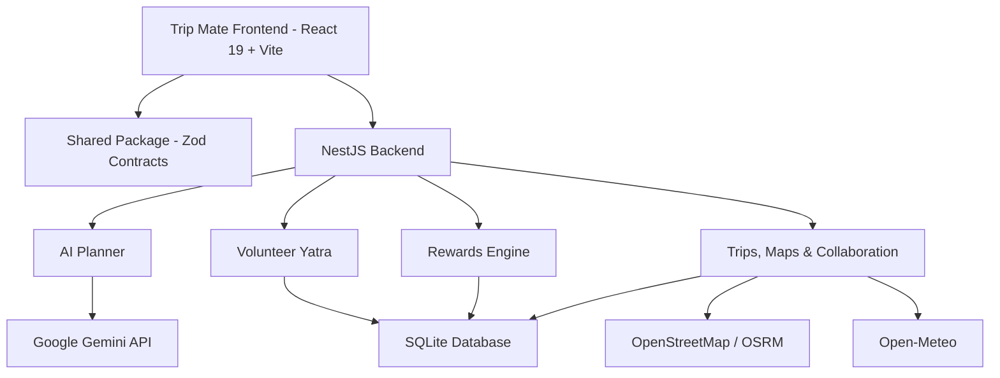

# Trip Mate

<div align="center">

<picture>
  <source media="(prefers-color-scheme: dark)" srcset="docs/logo-tripmate-light.svg" />
  <source media="(prefers-color-scheme: light)" srcset="docs/logo-tripmate-dark.svg" />
  
</picture>

<br />

<picture>
  <source media="(prefers-color-scheme: dark)" srcset="docs/subtitle-light.png" />
  <source media="(prefers-color-scheme: light)" srcset="docs/subtitle-dark.png" />
  
</picture>

<p align="center">
  <b>A modern, self-hosted, real-time collaborative travel planning and management platform.</b><br />
  Featuring intelligent AI itinerary planning, purposeful volunteer journeys (Volunteer Yatra), gamified rewards, interactive maps, split budgets, packing checklists, and offline-first PWA capabilities.
</p>

[](LICENSE)
[](https://nodejs.org/)
[](https://nestjs.com/)
[](https://react.dev/)
[](https://www.typescriptlang.org/)
[](https://www.sqlite.org/)
[](https://tailwindcss.com/)

</div>

---

## Showcase

<div align="center">
  
  <br /><br />
  
  <br /><br />
  
</div>

---

## Table of Contents

- [Overview](#overview)
- [Core Feature Modules](#core-feature-modules)
  - [AI Planner & Travel Assistant](#1-ai-planner--travel-assistant)
  - [Volunteer Yatra](#2-volunteer-yatra-travel-learn--earn)
  - [Rewards & Leaderboard](#3-rewards--leaderboard)
  - [Existing Platform Capabilities](#existing-platform-capabilities)
- [System Architecture](#system-architecture)
- [Technology Stack](#technology-stack)
- [Installation & Setup](#installation--setup-windows-powershell)
- [Configuration](#configuration--environment-variables)
- [Development, Build & Test Commands](#development-build--test-commands)
- [Database & API Architecture](#database--api-architecture)
- [Security Considerations](#security-considerations)
- [Project Limitations](#project-limitations--disclaimers)
- [Data Sources & Attributions](#data-sources--attributions)
- [License](#license)

---

## Overview

**Trip Mate** is a self-hosted travel planning and management platform designed to bring trip planning, collaboration, budgeting, and travel experiences into one unified workspace.

Whether planning an individual expedition, coordinating a road trip with friends, or participating in community volunteering programs, Trip Mate provides the tools needed to organize and manage the entire journey.

### Three Core Modules

1. **AI Planner:** Google Gemini-powered personalized itinerary generation and conversational travel assistance.
2. **Volunteer Yatra:** A volunteering opportunity marketplace with application management, benefits, and stipend tracking.
3. **Rewards & Leaderboard:** A gamification system rewarding sustainable travel, trip completion, and community contributions.

---

## Core Feature Modules

### 1. AI Planner & Travel Assistant

The AI Planner uses Google Gemini to generate personalized, structured travel itineraries.

**Itinerary Generation**
- Destination and travel date selection.
- Budget tiers and currency selection.
- Travel styles: backpacking, cultural, luxury, adventure, relaxation, and family.
- Interest-based recommendations.
- Season-aware planning.
- Structured day-by-day itineraries.
- Morning, afternoon, and evening activity schedules.
- Estimated activity costs and descriptions.

**Create Trip Integration**

Convert generated itineraries directly into persistent Trip Mate trips, including days, timeline entries, and map markers.

**AI Travel Assistant**

Conversational travel assistance for recommendations, local customs, packing advice, and itinerary modifications.

**Secure AI Configuration**

- Backend-only Gemini API integration.
- Secure API key isolation.
- AI configuration status endpoint.
- Validated structured AI responses.

### 2. Volunteer Yatra (Travel, Learn & Earn)

Volunteer Yatra connects travelers with educational, ecological, and community volunteering opportunities.

**Opportunity Marketplace**
- Organic farming.
- Rural education.
- Wildlife rescue.
- Hostel hospitality.
- Eco-trail development.
- Search and filtering by location, duration, and stipend.

**Application Management**
- Persistent application submissions.
- Applicant information and motivation statements.
- Duplicate application prevention.
- Application status tracking.

Supported statuses:
- PENDING
- ACCEPTED
- REJECTED
- COMPLETED
- CANCELLED

**Stipend & Benefits**
- Accommodation information.
- Meals and additional benefits.
- Certificates.
- Monthly or weekly stipend details.

**Favorites & Bookmarks**

Authenticated users can bookmark opportunities and access their saved listings.

> Note: Volunteer opportunities and stipend amounts are curated demonstration records. They do not represent legally binding employment contracts or independently verified commercial agreements.

### 3. Rewards & Leaderboard

Trip Mate includes a gamification system that encourages sustainable travel and community engagement.

**Points Engine**
- Trip completion: +500 points.
- Volunteer participation.
- Eco-friendly milestones.
- Packing checklist completion.

**Leaderboard**
- Global traveler rankings.
- Bronze Explorer.
- Silver Voyager.
- Gold Adventurer.
- Platinum Wanderer.

**Reward Catalog**
- Travel perks.
- Partner gear discounts.
- Digital certificates.
- Hostel vouchers.
- Point redemption and transaction history.

> Note: Reward redemptions demonstrate in-app gamification functionality. External merchant redemption requires third-party commercial integrations.

### Existing Platform Capabilities

Trip Mate also includes:

| Feature | Capabilities |
|---|---|
| Interactive Maps | Leaflet, MapLibre GL, OpenStreetMap, POI discovery and routing |
| Real-time Collaboration | WebSocket-based shared trip updates |
| Expense Management | Multi-currency splitting, custom shares and settlements |
| Budget Management | Trip budgets, expense tracking and CSV exports |
| Packing Lists | Categorized checklists, assignments and baggage tracking |
| Reservations | Flight, train, hotel and rental documentation |
| Offline PWA | IndexedDB caching and offline mutation queues |
| Atlas | Visited countries and geographical exploration |
| Travel Journal | Travel stories and multimedia memories |

---

## System Architecture

Trip Mate follows a modular monorepo architecture using React, NestJS, SQLite, and shared TypeScript contracts.

### High-Level Architecture



### Monorepo Workspace Structure

```text
TripMate/
├── client/                 # React 19 + Vite frontend
│   ├── src/
│   │   ├── components/
│   │   ├── pages/
│   │   ├── services/
│   │   └── store/
│   └── package.json
│
├── server/                 # NestJS backend
│   ├── src/
│   │   └── nest/
│   │       ├── ai/
│   │       ├── volunteer/
│   │       ├── rewards/
│   │       ├── database/
│   │       └── ...
│   ├── data/
│   ├── .env
│   └── package.json
│
├── shared/                 # Shared contracts and schemas
│   ├── src/
│   ├── dist/
│   └── package.json
│
├── docs/
├── package.json
├── package-lock.json
├── LICENSE
└── README.md
```

---

## Technology Stack

| Layer | Technology |
|---|---|
| Frontend | React 19 |
| Build Tool | Vite 8 |
| Language | TypeScript |
| Styling | Tailwind CSS |
| State Management | Zustand |
| Mapping | Leaflet & MapLibre GL |
| Backend | NestJS 11 |
| AI Integration | Google Gemini SDK |
| Database | SQLite / better-sqlite3 |
| Real-time Sync | WebSockets |
| Validation | Zod 4 |
| Authentication | Passport, JWT, WebAuthn |
| Package Management | npm Workspaces |

---

## Installation & Setup (Windows PowerShell)

### Prerequisites

- Node.js 22 LTS.
- npm 10 or higher.
- Git 2.x.
- Google Chrome or another modern browser.

### Step 1: Clone the Repository

```powershell
git clone https://github.com/dakshgola/TripMate.git
cd TripMate
```

Ensure you are inside the directory containing the root `package.json`.

### Step 2: Install Dependencies

```powershell
npm install
```

### Step 3: Build Shared Package

```powershell
npm run build --workspace=shared
```

### Step 4: Configure Environment

```powershell
Copy-Item server\.env.example server\.env
```

Open `server/.env` and configure your Gemini API key:

```dotenv
GEMINI_API_KEY=your_actual_gemini_api_key_here
```

Never commit your actual API key.

### Step 5: Start Trip Mate

```powershell
$env:NODE_OPTIONS = "--max-old-space-size=4096"
npm run dev
```

### Step 6: Open the Application

| Service | URL |
|---|---|
| Trip Mate Frontend | http://localhost:5173 |
| Backend API | http://localhost:3001 |
| AI Configuration Status | http://localhost:3001/api/ai/status |

---

## Configuration & Environment Variables

Backend configuration is managed through `server/.env`.

| Variable | Description |
|---|---|
| PORT | Backend server port (3001) |
| NODE_ENV | Development or production |
| TZ | Server timezone |
| ALLOWED_ORIGINS | Allowed frontend origins |
| COOKIE_SECURE | Secure cookie configuration |
| ENCRYPTION_KEY | Encryption key for sensitive stored credentials |
| GEMINI_API_KEY | Google Gemini API key |

### Gemini API Key Security

- API keys remain exclusively on the backend.
- No `VITE_GEMINI_API_KEY` exposure.
- No Gemini credentials in browser storage.
- All AI requests pass through authenticated backend endpoints.
- AI status endpoints must never expose secrets.

---

## Development, Build & Test Commands

Run commands from the repository root.

### Development

```powershell
npm run dev
npm run dev --workspace=server
npm run dev --workspace=client
npm run build:watch --workspace=shared
```

### Production Build

```powershell
npm run build
```

Individual workspace builds:

```powershell
npm run build --workspace=shared
npm run build --workspace=server
npm run build --workspace=client
```

### Testing & Code Quality

```powershell
npm run test
npm run test:cov
npm run lint
npm run format
npm run format:check
```

Run only commands that are actually defined in the corresponding package scripts.

---

## Database & API Architecture

### SQLite Persistence

Trip Mate uses SQLite with `better-sqlite3`.

- Database: `server/data/travel.db`
- WAL mode for concurrent read/write operations.
- Automated database migrations.
- Persistent trip, user, application, and reward data.

### REST API Endpoints

#### AI Planner

| Method | Endpoint | Purpose |
|---|---|---|
| GET | `/api/ai/status` | AI configuration status |
| POST | `/api/ai/plan-itinerary` | Generate itinerary |
| POST | `/api/ai/chat` | Conversational travel assistant |

#### Volunteer Yatra

| Method | Endpoint | Purpose |
|---|---|---|
| GET | `/api/volunteer/opportunities` | Browse opportunities |
| GET | `/api/volunteer/opportunities/:id` | Opportunity details |
| POST | `/api/volunteer/applications` | Submit application |
| GET | `/api/volunteer/applications/mine` | User applications |
| PATCH | `/api/volunteer/applications/:id/status` | Update application |
| GET | `/api/volunteer/favorites` | Saved opportunities |
| POST | `/api/volunteer/favorites/:id` | Toggle favorite |

#### Rewards

| Method | Endpoint | Purpose |
|---|---|---|
| GET | `/api/rewards/leaderboard` | Leaderboard |
| GET | `/api/rewards/me` | User points and history |
| GET | `/api/rewards/catalog` | Reward catalog |
| POST | `/api/rewards/redeem` | Redeem rewards |
| POST | `/api/rewards/trips/:tripId/complete` | Award trip completion points |

---

## Security Considerations

1. Backend-only AI credential management.
2. Encrypted sensitive credential storage using AES-256-GCM.
3. HTTP-only session cookies and JWT authentication.
4. Input sanitization and Zod validation.
5. SSRF protection for outbound network requests.
6. Environment secrets excluded from version control.

---

## Project Limitations & Disclaimers

- AI functionality depends on Google Gemini availability and API quotas.
- SQLite is designed primarily for single-node deployment.
- Offline functionality does not extend to AI generation, live geocoding, or WebSocket synchronization.
- Volunteer listings are demonstration records.
- Reward redemption is simulated unless external integrations are implemented.

---

## Data Sources & Attributions

- **Geographical Boundaries:** [geoBoundaries](https://www.geoboundaries.org/) — CC BY 4.0.
- **Maps and POI Data:** [OpenStreetMap](https://www.openstreetmap.org/), [Overpass API](https://overpass-turbo.eu/), and [OSRM](https://project-osrm.org/).
- **Weather:** [Open-Meteo](https://open-meteo.com/).
- **Currency Exchange:** [Frankfurter](https://www.frankfurter.app/).

**Upstream Attribution:** Trip Mate is based on and adapted from the open-source Trek travel planner project by Maurice Boe and community contributors. Original upstream credits and applicable license obligations are retained.

---

## License

Trip Mate is licensed under the **GNU Affero General Public License v3.0 (AGPL-3.0)**.

See the [LICENSE](LICENSE) file for complete licensing information.

---

<div align="center">

**Trip Mate — Your Trip. Your Plan.**

Plan smarter. Travel together. Explore more.

</div>
